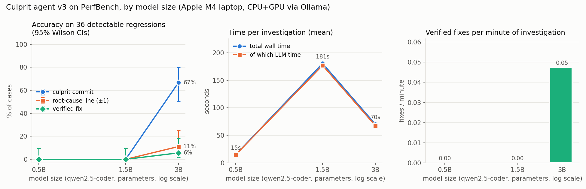

# Can a small local LLM agent diagnose performance regressions?

*Culprit and PerfBench: method, results, failure modes, limitations.*
All numbers come from `results/metrics.json`, `results/false_alarm.json`,
`results/regression_calibration.json` and `results/model_size.json`.

## 1. Problem

When a benchmark gets slower, someone has to answer four questions:
- Is the slowdown real or noise?
- Which commit caused it?
- Which line, and why?
- What's the fix, and does it actually restore performance?

Bug-fixing agents are common. Performance agents are rarer, because timings on a real machine are noisy and every claim needs a measurement behind it. We built an agent where measurement and verification are deterministic code, and an LLM is used only for the reasoning steps. Then we measured how often it is right, using small models that run on a laptop.

## 2. Method

**Measurement engine.** Two commits are checked out into temporary git worktrees, and each runs in a long-lived worker process so setup isn't timed. After 3 discarded warm-ups, runs are interleaved with alternating order (A,B / B,A / ...) for 15 rounds, up to 40 if the result is unclear. The effect size is $r = \mathrm{median}(t_B)/\mathrm{median}(t_A)$, with a 95% bootstrap CI (2,000 resamples) and a one-sided Mann-Whitney U test. Verdict, with $\tau = 0.05$:
- *regression* if $\mathrm{CI}_{low} > 1+\tau$ and $p < 0.01$,
- *no regression* if $\mathrm{CI}_{high} < 1+\tau$,
- *inconclusive* otherwise.

**Bisect** is a binary search where each step measures a commit against the good one. A step is classified "slow side" or "fast side" when its CI lies entirely above or below $\sqrt{R}$, where $R$ is the full slowdown. Otherwise the step is inconclusive and bisect stops rather than guessing.

**Agent.** A local model (qwen2.5-coder via Ollama, temperature 0) chooses among 8 sandboxed tools for up to 15 steps:

| tool | what it does |
|---|---|
| bisect | finds the first slow commit |
| run_benchmark | measures two commits |
| profile | cProfile, before vs after |
| show_diff, read_file, search_code | look at the code |
| propose_patch | validates a fix without applying it |
| verify_patch | applies the fix to a copy, re-measures, runs the tests |

A deterministic **hand-off** rule marks a result *verified* only if all of these hold:
- bisect agrees with the LLM's commit,
- confidence isn't low,
- the patch is significantly faster than the bad commit,
- the tests pass.

Anything else is handed to a human with the evidence.

**PerfBench.** 63 git histories built from a real Python HNSW implementation (semantic-paper-search @ 5cc47e0), each with 16-32 commits:
- **51 contain one planted slowdown** at a random position, among benign commits (comments, docs, tests, unused helpers, renames). About half of those slow commits bundle an unrelated edit to the same file.
- **12 controls** have no slowdown.

The planted slowdowns come from 17 types: algorithmic, de-vectorization, copying, lost caching, logging in a hot path, allocation churn, configuration. Every one keeps the 46-test suite passing. A calibration run measured each type's true effect:
- **12 types are clearly detectable** (1.10× to 9.38×), giving 36 cases.
- **5 types are 0-6%**, giving 15 sub-threshold probes.

Three of our own guesses were wrong at calibration (one "slow" change was 14% faster; two had no effect), and those were dropped.

**Systems compared.**
- *classic*: bisect + profiler + a rule that picks the changed line inside the function whose self-time grew most. No LLM, no fix.
- *LLM only*: the model sees the true culprit diff and must explain and fix it.
- *Culprit v1-v3*.

Prompts were developed on a separate 4-case dev set. Each improvement after v1 came from the failure analysis of the previous version.

**Metrics.**
- Culprit commit.
- Root-cause line within ±5 lines, and a stricter ±1. The ±5 rule rewards citing a diff hunk's first line, which sits 3 context lines above the change.
- Verified fix.
- False fix: verified but wrong commit or line, or failing the 9 held-out slow tests.

Rates have 95% Wilson intervals.

## 3. Results

**Measurement.** On every detectable case and every system:
- **36/36 detectable regressions detected** (CI 90-100%).
- **0/12 false alarms on controls** (CI 0-24%).
- **0/60 false alarms** comparing identical code against itself (30 per benchmark; ratios between 0.969 and 1.027).
- 3 of the 15 sub-threshold probes were flagged.

**Diagnosis (3B model, 36 detectable cases):**

| system | commit | line ±5 | line ±1 | verified fix | false fix |
|---|---|---|---|---|---|
| classic (no LLM) | 100% | 97% | 97% | – | – |
| LLM only, given the diff | given | 100% | 0% | 8% (3) | 0/3 |
| Culprit v1 | 100% | 0% | 0% | 0% | – |
| Culprit v2: + evidence gate | 39% | 36% | 6% | 3% (1) | 0/1 |
| Culprit v3: + tolerant patch input | 67% | 61% | 11% | 6% (2) | 0/2 |

The agent is scored on its final answer, so a run that hits the step limit counts as wrong even though bisect had found the commit.

**Model size (Culprit v3):**

| model | commit | line ±1 | verified | what it does |
|---|---|---|---|---|
| 0.5B | 0% | 0% | 0% | never calls a tool: repeats a made-up answer for 15 steps |
| 1.5B | 0% | 0% | 0% | navigates correctly (bisect → diff → file), then can't produce a valid patch call (pastes whole diffs; loops) |
| 3B | 67% | 11% | 6% | locates the commit and line in most cases; rarely writes a working fix |

Given the true diff and no tools, the same models cite the right region at ±5 in 50% (0.5B), 97% (1.5B) and 100% (3B) of cases, but **0% at ±1** at every size.

Timing: 15 s (0.5B), 181 s (1.5B) and 70 s (3B) per investigation. The 3B timing is inflated: Ollama was in a degraded state during that run (the identical no-tools call took 4.6 s per case in an earlier run and 71 s in this one), so cross-size time comparisons are unreliable.

## 4. Failure modes and improvements

Every miss was classified automatically from its trace (`results/failure_analysis.md`).

| version | main failure | what we changed | effect |
|---|---|---|---|
| v1 | in 36/36 cases, answered right after bisect without reading code, inventing a file (`search.py:100` in 21 cases) | **evidence gate**: a final answer is refused until the agent has read code, proposed a patch and verified it | line ±5: 0% → 36% |
| v2 | 20 of 35 misses looped on `propose_patch`, pasting diff markers and line-number prefixes; a separate bug silently produced mis-indented patches | **tolerant patch input**: deterministic cleanup plus a unique-match search | loops 20 → 10; line ±5: 36% → 61% |
| v3 | patch didn't help 10, looped 10, patch crashed 8, broke tests 2, wrong line 2, out of steps 2 | – | – |

The dominant remaining v3 pattern is **right diagnosis, wrong fix**. Example: a correct explanation of a de-vectorized distance loop, with a patch that pastes the slow line elsewhere; measured 0.99×, refused. In one case a "fix" silently dropped graph links (`e in self.graph` on a list); the tests caught it.

**No false fixes in any run.** Verification measured or tested every claimed fix.

## 5. Discussion

- **Deterministic tools do the locating.** Statistics and bisect were perfect on detection and commit-finding. Once the commit is known, a profiler-guided rule finds the line 97% of the time. On this benchmark the LLM's added value would be the explanation and the fix.
- **A capability threshold, not a smooth curve.** Below 3B the models can't complete the tool-use workflow at all (0.5B never calls tools; 1.5B can't produce a valid patch call). At 3B the agent reliably locates the problem but rarely repairs it.
- **Guardrails are what make a weak model safe to run.** The evidence gate and verification turned a model that invents answers into one that hands off honestly: 0 false fixes, every miss explained.
- **Deterministic harness fixes beat prompt changes.** Both improvements were code in the harness, and each targeted the largest failure category.

## 6. Limitations

- **Small, synthetic benchmark.** 36 detectable cases in two files (~350 lines) of one Python project, so the CIs are wide (e.g. 6% verified = 2/36, CI 2-18%). The regressions were written by us and are usually single-hunk, which makes line-finding easier than in real large commits.
- **One machine** (Apple M4 laptop). Sub-5% slowdowns are deliberately reported as "no regression".
- **Only small models** (≤ 3B) were tested; 7B+ is the obvious next experiment.
- **The no-tools baseline gets the true diff** (an oracle advantage on commit-finding).
- **Measurements are cached per case and shared by all systems,** so systems are compared on identical measurement outcomes. Cached comparisons don't count toward reported time.
- **Unreliable timing on one run:** the 3B v3 and no-tools runs were affected by a degraded Ollama server.
